# Custom VPC on AWS: Public and Private Subnets

A hands-on AWS networking project. I built my own **Virtual Private Cloud (VPC)** with a **public subnet** that serves a web page to the internet and a **private subnet** that has no internet access, then tested that the two tiers can talk to each other while the private server stays hidden.

**Region:** Asia Pacific (Mumbai), `ap-south-1`

## Architecture

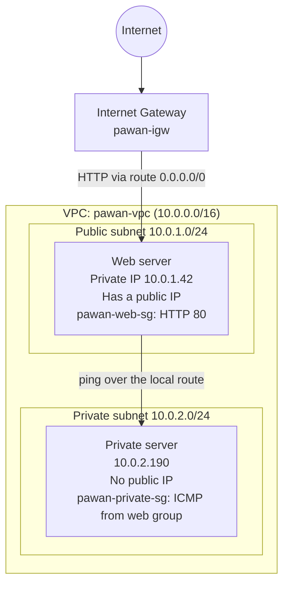

## What I Built

| Component | Name | Details |
|---|---|---|
| VPC | `pawan-vpc` | `10.0.0.0/16`, DNS hostnames enabled |
| Public subnet | `pawan-public-subnet` | `10.0.1.0/24`, `ap-south-1a`, auto-assign public IPv4 on |
| Private subnet | `pawan-private-subnet` | `10.0.2.0/24`, `ap-south-1a`, no public IPs |
| Internet gateway | `pawan-igw` | Attached to `pawan-vpc` |
| Public route table | `pawan-public-rt` | `10.0.0.0/16 → local` and `0.0.0.0/0 → internet gateway`, associated with the public subnet |
| Private route table | `pawan-private-rt` | `10.0.0.0/16 → local` only, associated with the private subnet |
| Web security group | `pawan-web-sg` | Inbound: HTTP (TCP 80) from `0.0.0.0/0` |
| Private security group | `pawan-private-sg` | Inbound: All ICMP (IPv4) from `pawan-web-sg` only |
| Web server | EC2 (Amazon Linux 2023, `t3.micro`) | In the public subnet, runs Apache installed through user data |
| Private server | EC2 (Amazon Linux 2023, `t3.micro`) | In the private subnet, no public IP |
| IAM role | `pawan-ec2-ssm-role` | `AmazonSSMManagedInstanceCore`, so I could open a terminal without SSH |

## How the Design Works

- **What makes a subnet public:** a subnet is public because its route table sends `0.0.0.0/0` to the internet gateway, not because of its name. The private subnet's route table has no such route, so nothing in it can reach the internet or be reached from it.
- **Controlled access between tiers:** the private security group allows traffic only from servers that belong to the web security group. It references the group, not an IP range.
- **No SSH exposed:** port 22 was never opened. I connected to the web server with AWS Systems Manager Session Manager, which needs no key pair and no inbound rule.
- **No NAT gateway:** the private server does not need outbound internet access in this project, so I skipped the NAT gateway and its hourly cost.

## How I Tested It

1. **Public access works:** opening the web server's public IP in a browser over HTTP showed my test page.
2. **Private connectivity works:** from the web server (through Session Manager) I pinged the private server at `10.0.2.190`. All 4 packets were received, with 0% packet loss.
3. **Private server is hidden:** the private server has no public IPv4 address, so there is nothing on the internet to connect to.

## Screenshots

### Network overview
The VPC and its resources on the resource map.

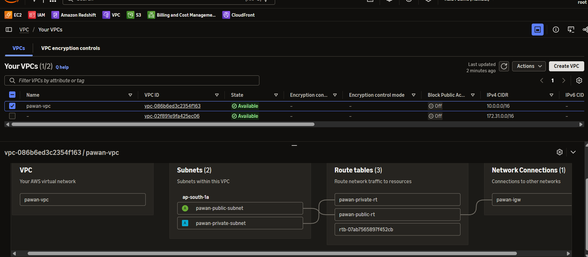

VPC details: `10.0.0.0/16`, DNS hostnames and DNS resolution enabled.

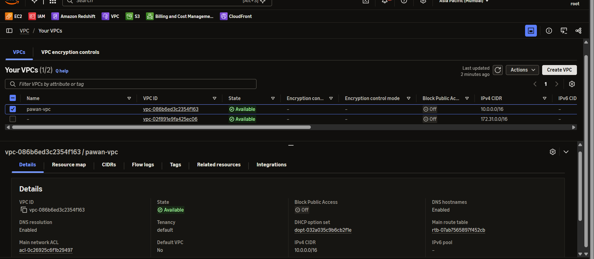

### Subnets
Public subnet, `10.0.1.0/24`, associated with the public route table.

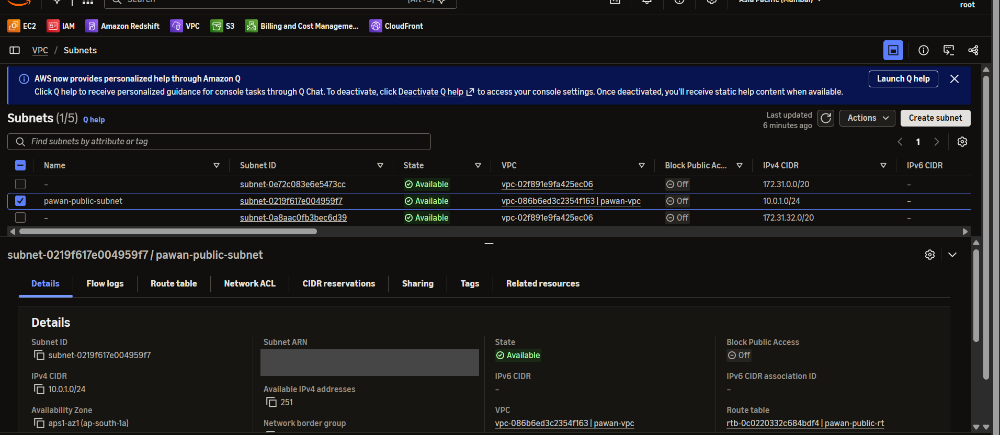

Private subnet, `10.0.2.0/24`, associated with the private route table.

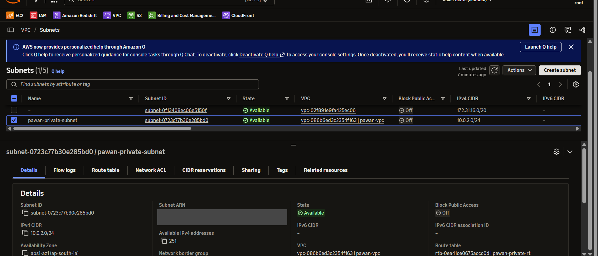

### Internet gateway and routing
Internet gateway attached to `pawan-vpc`.

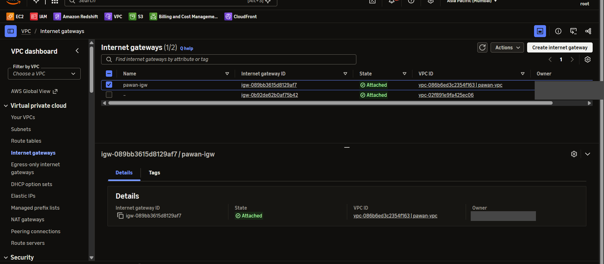

Public route table, with a route to the internet gateway.

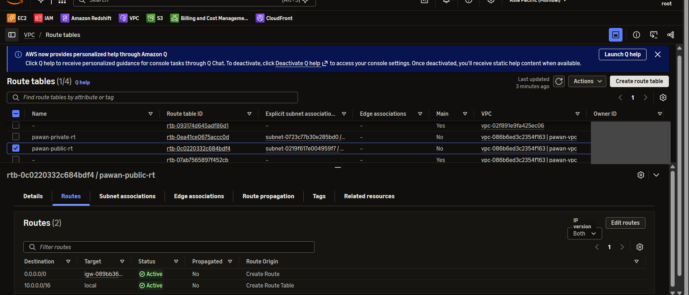

Private route table, with only the local route.

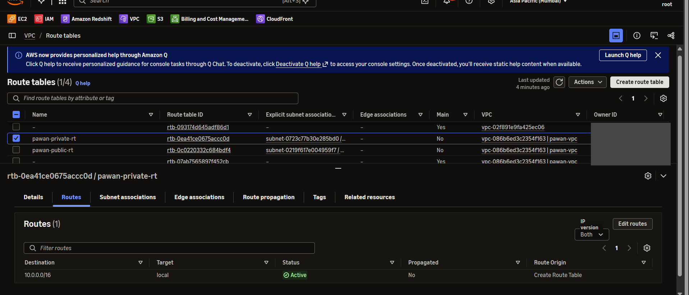

### Security groups
Web server group, allowing HTTP on port 80.

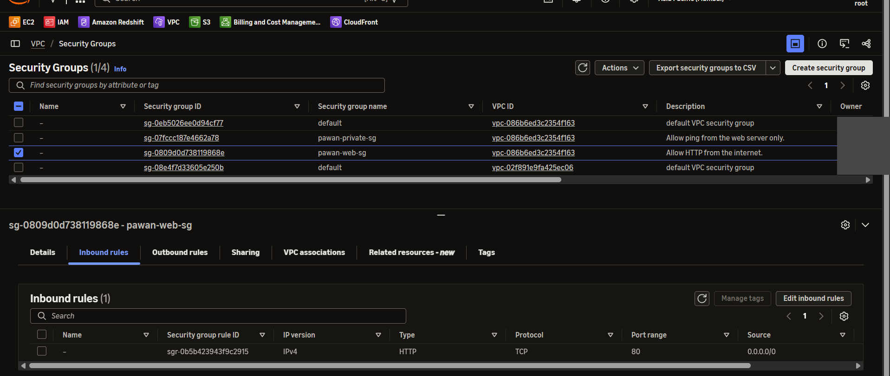

Private server group, allowing ICMP only from the web security group.

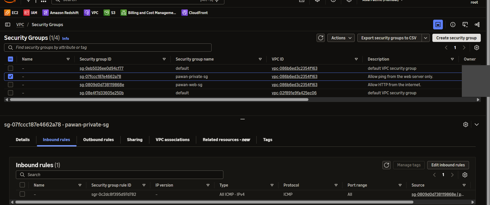

### Servers
Web server, with a public IP and the private address `10.0.1.42`.

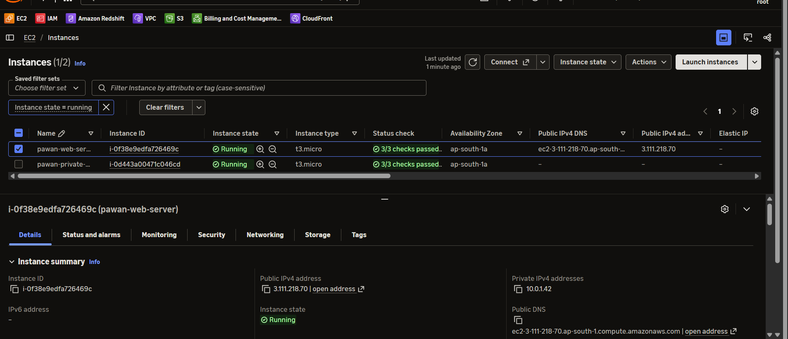

Private server, with no public IP and the private address `10.0.2.190`.

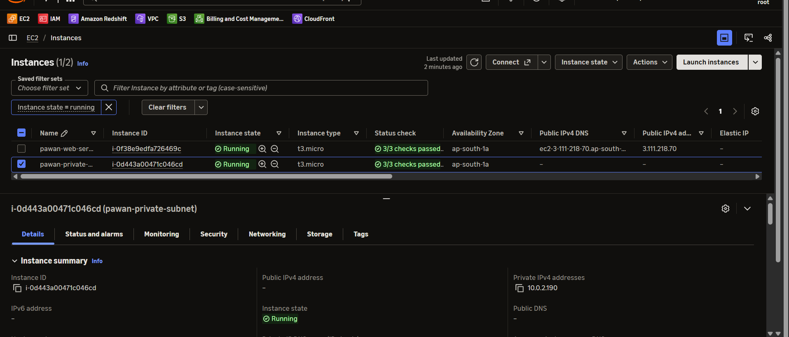

### Test results
The web page served from the public subnet.

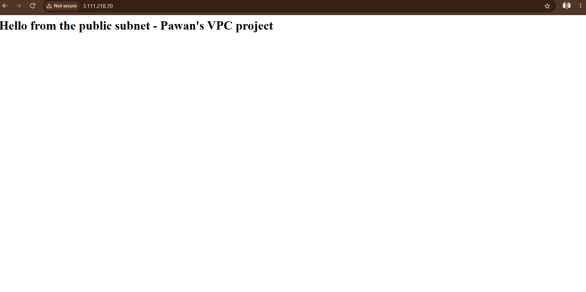

Ping from the web server to the private server: 4 sent, 4 received, 0% packet loss.

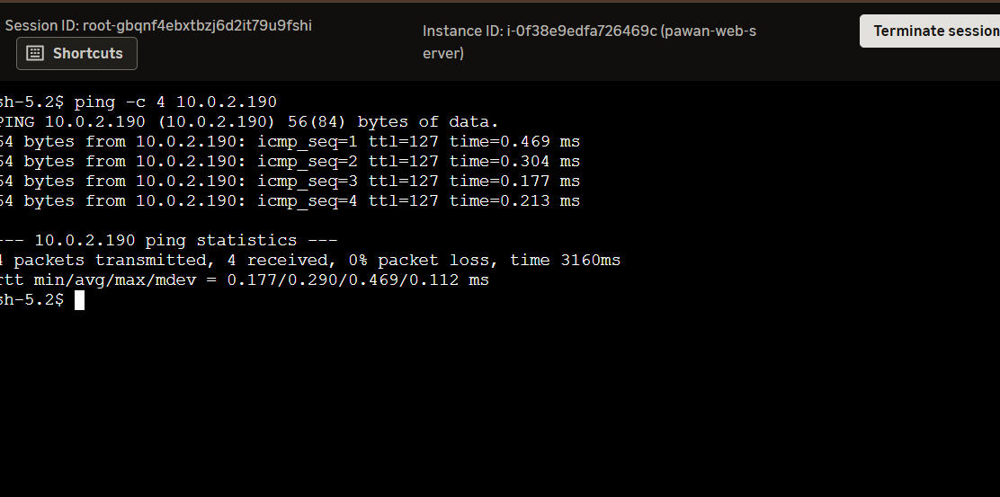

## Cost Control

- I tested everything in one session and **terminated both EC2 instances** immediately afterwards, so no server or public IP kept running.
- I did not create a NAT gateway or an Elastic IP.
- I kept AWS budget alerts active on the account while working.

## Challenges and What I Learned

- **Default VPC:** AWS creates a default VPC in every region, and it is often preselected in forms. I had to check the VPC field on every screen to make sure resources landed in `pawan-vpc`.
- **Subnet CIDR:** the console suggested a `/20` range for my subnet. I changed it to `/24` so the two subnets would not overlap.
- **Security group list:** a security group only appears in the launch screen if it belongs to the VPC you selected. My private group was missing until I created it inside `pawan-vpc`.
- **Connection method:** EC2 Instance Connect uses SSH, which my security group did not allow. Session Manager worked without opening any port.
- **Stale console tabs:** the AWS console does not refresh itself, so I learned to reload before trusting what a tab shows.

## Possible Improvements

- Add a second Availability Zone with another public and private subnet for high availability.
- Add a NAT gateway so the private subnet can download updates (while managing its hourly cost).
- Rebuild the whole network with Terraform (Infrastructure as Code).
- Turn on VPC Flow Logs to inspect traffic.
- Serve the web page over HTTPS behind a load balancer.

## Author

**Pawan Kalyan Matta**
LinkedIn: https://www.linkedin.com/in/pawan-kalyan-matta
